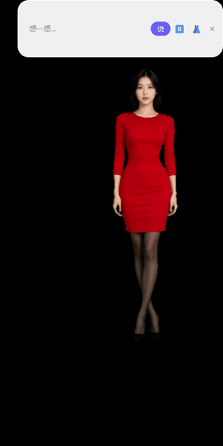

# GlassMate 玻璃伴侣

**本地优先的真人风格桌面AI伴侣框架** — 透明桌宠 · 实时口型 · AI换装 · 全程离线

Local-first desktop AI companion framework — transparent pet overlay, real-time lip-sync digital human, AI wardrobe, 100% offline.



## 它能做什么

- 🧍 **真人风格数字人桌宠**：无边框透明窗口常驻桌面，不是二次元纸片人，是照片级真人形象（口型实时驱动）
- 👗 **一句话换装**：衣橱面板输入"白色JK制服"，AI本地生成新服装，点"换上"2-3分钟生效
- 🗣️ **无限制本地对话**：接Ollama本地大模型（去审查版），说什么她都不会拒绝你（请遵守当地法律）
- 🔊 **实时语音**：Edge TTS中文女声（可升级GPT-SoVITS音色克隆），说话可打断
- 💬 **思考云朵交互**：白色云朵输入气泡 + 回复字幕云朵，滚轮缩放，随手拖动
- 🔒 **全程离线**：对话、生图、语音全部本地推理，拔网线照样能聊

## 架构

```
你(文字/语音) → Ollama本地LLM(无审查) → Edge TTS → LiveTalking(wav2lip口型驱动)
                                                        ↓ WebRTC
换装管线: SDXL生图 → birefnet抠像 → 绿幕合成 → genavatar → 桌宠透明渲染(PySide6+OpenCV抠绿)
```

| 组件 | 作用 | 上游 |
|------|------|------|
| client/desktop_pet.py | 透明桌宠客户端(抠像/缩放/衣橱UI/自动重连) | 本项目原创 |
| tools/change_outfit.py | AI换装(Qwen-Image-Edit指令式重绘) | 本项目原创 |
| tools/apply_outfit.py | 一键换装(重建avatar+重启服务+自动重连) | 本项目原创 |
| tools/gen_green_img.py | 绿幕全身形象生成(SDXL) | 本项目原创 |
| tools/make_greenscreen.py | birefnet抠像→纯绿幕合成 | 本项目原创 |
| [LiveTalking](https://github.com/lipku/LiveTalking) | 实时数字人引擎(wav2lip) | MIT |
| [Ollama](https://ollama.com) | 本地LLM推理 | MIT |
| [ComfyUI](https://github.com/comfyanonymous/ComfyUI) | 生图后端 | GPL-3.0 |

## 硬件要求

- NVIDIA显卡 ≥8G显存（RTX 3060/4060/5060级别实测可跑）
- 32G内存更稳，硬盘预留30G
- Windows 10/11（Linux理论可跑，未验证）

## 快速开始

```bash
# 1. 安装LiveTalking(参考其官方文档) + Ollama
# 2. 拉取去审查中文模型
ollama create qwen2.5-abliterated -f Modelfile   # 见 docs/model.md

# 3. 克隆本仓库, 装客户端依赖
pip install PySide6 opencv-python aiortc aiohttp numpy sounddevice

# 4. 配置(环境变量或改 tools/gm_config.py)
#    GLASSMATE_HOME=LiveTalking路径

# 5. 启动服务+桌宠
python tools/apply_outfit.py  # 首次会构建默认avatar
python client/desktop_pet.py
```

详细部署教程（含所有坑）：[docs/install.md](docs/install.md)

## 换装玩法

```bash
# 生成新服装(需要ComfyUI+SDXL+Qwen-Image-Edit模型)
python tools/change_outfit.py "白色JK制服，黑色过膝袜" --name jk制服

# 一键换上(重建avatar+自动重启服务)
python tools/apply_outfit.py jk制服
```

或直接在桌宠窗口点 👗 打开衣橱，图形界面操作。

## 免责声明

本项目仅供学习交流。使用者须遵守当地法律法规：
- 禁止生成、传播违法违规内容
- 禁止未经授权使用他人肖像/声音（定制形象仅限本人授权素材）
- 模型权重请遵守各自开源协议，本仓库不分发任何模型文件

## License

MIT © 2026 GlassMate contributors
上游组件遵循各自协议（LiveTalking MIT / ComfyUI GPL-3.0 / 各模型见其许可证）
